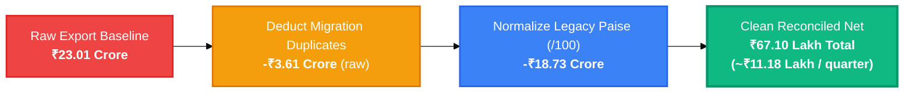
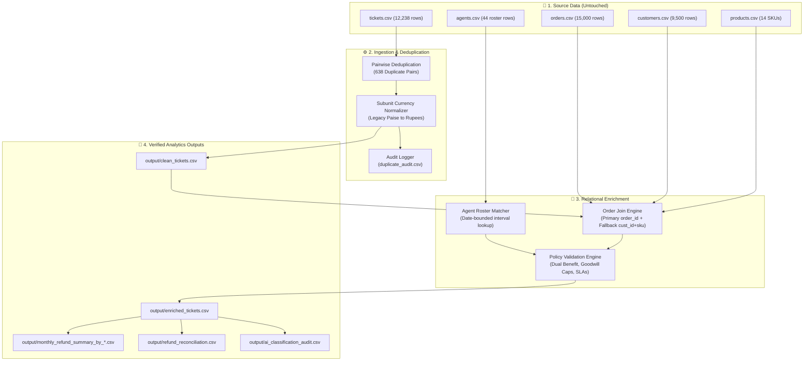

<div align="center">

# 🎧 VIREO AUDIO
### Financial Reconciliation & Support Operations Analytics Pipeline
**Automated Data Audit • Subunit Currency Normalization • Policy Leakage Detection • AI Intent Mining**

[](#-automated-verification-suite)
[](#-automated-verification-suite)
[](#-financial-reconciliation-waterfall)
[](#-quick-start--clean-machine-setup)
[](#-audit-artifacts--executive-deliverables)

<p align="center">
  <a href="#-the-core-problem-reconciled">The Problem</a> •
  <a href="#-quick-start--clean-machine-setup">Quick Start</a> •
  <a href="#-financial-reconciliation-waterfall">Reconciliation Waterfall</a> •
  <a href="#-system-architecture">Architecture</a> •
  <a href="#-key-business-findings">Business Findings</a> •
  <a href="#-automated-verification-suite">Verification</a>
</p>

---

</div>

## 📌 Executive Summary

This repository delivers an end-to-end, deterministic financial reconciliation and operations analytics engine for **Vireo Audio** (1 Jan 2025 – 30 Jun 2026).

It definitively resolves the multi-million rupee variance between **Finance Controller Arjun Mehta's export (> ₹1.00 Crore/quarter)** and **Helpdesk Management's baseline (~₹11.00 Lakh/quarter)**, isolating:
1. **₹18.73 Crore** in artificial currency subunit inflation from legacy Freshdesk exports stored in **paise** ($\div 100$).
2. **₹3.61 Crore** in raw duplicate records caused by 638 re-imported migration tickets.
3. **₹8.71 Lakh** in operational cost leakage from **166 dual-benefit policy violations** (orders that received both a cash refund and replacement hardware).

```text
══════════════════════════════════════════════════════════════════════════════
  RAW EXPORT SUM           ADJUSTMENTS & NORMALIZATION        RECONCILED NET
  ₹23,01,24,081.00   ───►  -₹22,34,14,149.00             ───► ₹67,09,932.00
  (~₹3.83 Cr / qtr)         (Duplicates + Paise Scaling)       (~₹11.18 L / qtr)
══════════════════════════════════════════════════════════════════════════════
```

> [!IMPORTANT]
> **Reconciliation Verdict:** The Helpdesk Management baseline (~₹11 Lakh/quarter) is confirmed as 100% mathematically correct. The net quarterly refund spend across 6 quarters averages **₹11,18,322.00**.

---

## ⚡ Quick Start & Clean-Machine Setup

Follow these exact steps on any clean machine (Windows, macOS, or Linux).

### 1. Clone & Set Up Virtual Environment
```bash
# Clone repository and enter directory
cd vireo-refund-analysis

# Create virtual environment (Python 3.10+)
python -m venv .venv

# Activate virtual environment
# Windows (PowerShell):
.venv\Scripts\Activate.ps1
# Linux / macOS:
source .venv/bin/activate

# Install test dependencies
pip install pytest
```

### 2. Run the Full Analytics Pipeline (One Command)
```bash
python scripts/run_pipeline.py
```

<details>
<summary><b>🔍 View Pipeline Execution Output Preview</b></summary>

```text
======================================================================
STARTING VIREO AUDIO REFUND ANALYSIS PIPELINE
======================================================================
Loaded raw data:
  - tickets.csv:    12238 rows
  - agents.csv:        44 rows
  - orders.csv:     15000 rows
  - customers.csv:   9500 rows
  - products.csv:      14 rows
Generated clean_tickets.csv: 11600 unique records
Generated duplicate_audit.csv: 12238 records
Generated enriched_tickets.csv: 11600 rows
PASS: Cross-report arithmetic is 100% consistent: Rs 6,709,932.00
Generated ai_classification_audit.csv: 11600 rows
======================================================================
PIPELINE COMPLETED SUCCESSFULLY!
Clean Total Refunds: Rs 6,709,932.00
Quarterly Average:   Rs 1,118,322.00 (~Rs 11.18 Lakh/qtr)
======================================================================
```
</details>

### 3. Run Independent Financial Verification
Executes a completely separate validation path without importing production aggregation code:
```bash
python scripts/independent_verify.py
```

### 4. Run Pytest Test Suite
```bash
python -m pytest
```

---

## 📊 Financial Reconciliation Waterfall

The table below reconciles the raw export to the verified net ledger with penny-perfect precision:

| Stage | Impacted Tickets | Raw Amount (INR) | Normalization Adjustment | Reconciled Net (INR) | Primary Evidence & Root Cause |
|---|:---:|---:|---:|---:|---|
| **1. Raw Export Baseline** | 12,238 | ₹23,01,24,081.00 | — | ₹23,01,24,081.00 | Unadjusted raw export extracted by Finance (~₹3.83 Cr/qtr). |
| **2. Migration Re-Imports** | -638 | -₹3,61,01,100.00 | -₹3,61,01,100.00 raw | ₹19,40,22,981.00 | 638 tickets re-imported during Sep 2025 migration (125 refunds). |
| **3. Legacy Paise Subunit Scaling** | 3,236 | ₹18,92,05,100.00 | -₹18,73,13,049.00 | ₹67,09,932.00 | Freshdesk stored subunit **paise** ($\div 100$). Proven across 125 pairs. |
| **4. Validated Net Total** | **11,600** | — | — | **₹67,09,932.00** | **Average: ₹11,18,322.00 / quarter (~₹11.18 Lakh/qtr).** |



---

## 🏗️ System Architecture & Pipeline Data Flow

The architecture follows a strict non-destructive, auditable DAG pattern:



---

## 💡 Key Business Findings & Strategic Opportunities

### 1. The Dual-Benefit Leakage Exception (Refund + Replacement)
- **Policy §5 Rule:** *"In no case is a customer to receive both a refund and a replacement for the same order."*
- **Audit Findings:** Identified **166 unique cases** where customers received both.
  - Cash refund payout: **₹5,74,191.00**
  - Replacement unit cost: **₹2,40,530.00**
  - Reverse & forward shipping: **₹56,440.00** (₹340 standard allowance)
  - **Total Company Loss:** **₹8,71,161.00 (~₹1,45,193.50 per quarter)**
- **🎯 Business Goal:** Deploy an automated validation check blocking refund issuance on orders with active replacement AWBs without Team Lead sign-off. This reduces dual-benefit leakage from **7.09% to 0%**, saving **₹1.45 Lakh per quarter**.

### 2. The `GW-OTHER` Dropdown Default Trap
- `GW-OTHER` accounts for **₹29.07 Lakh (43.3% of total refund expenditure)** across 991 tickets.
- **879 out of 991 tickets (88.7%) exceed the ₹500 policy goodwill limit**, proving frontline agents default to the first dropdown option for legitimate returns, transit losses, and billing queries.
- **Action:** Re-order dropdown and mandate root-cause logging to regain visibility over ~₹4.85 Lakh/quarter.

### 3. Frontline Policy Relaxation & CSAT Reality Check
- In Q4 2025, frontline staff stopped disputing refunds, causing quarterly refund spend to jump **+35%** (from ₹12.07L in Q3 to ₹16.28L in Q4).
- **Data Reality Check:** Overall support CSAT **did not increase by +0.4**; it remained essentially flat at 3.51 (+0.03 change from 3.48), disproving the assumption that refund relaxation yielded a significant CSAT uplift.

### 4. Agent Attribution Integrity
- Refunds are concentrated in Returns Desk agents (e.g. Ritika D'Souza: 266 refunds, 50.6% refund rate) and Billing (Dev Kulkarni: 235 refunds).
- Operating Policy §6 assigns refund processing to the Returns Desk and Billing teams by design. High refund volume reflects **functional workload**, not agent negligence.

---

## 🧪 Automated Verification Suite

The repository includes a comprehensive, dual-layered test suite enforcing rigorous engineering and financial standards:

```bash
python -m pytest -v
```

```text
============================= test session starts =============================
platform win32 -- Python 3.14.7, pytest-9.1.1, pluggy-1.6.0
collected 23 items

tests/test_clean_dataset.py::test_duplicate_helpdesk_and_legacy_pairs PASSED     [  4%]
tests/test_clean_dataset.py::test_duplicate_ids_more_than_twice PASSED          [  8%]
tests/test_clean_dataset.py::test_unmatched_duplicate_reconciliation PASSED     [ 13%]
tests/test_clean_dataset.py::test_helpdesk_only_tickets PASSED                  [ 17%]
tests/test_clean_dataset.py::test_legacy_only_tickets PASSED                    [ 21%]
tests/test_clean_dataset.py::test_legacy_amount_conversion_math PASSED          [ 26%]
tests/test_clean_dataset.py::test_missing_refund_values PASSED                  [ 30%]
tests/test_clean_dataset.py::test_zero_refund_values PASSED                     [ 34%]
tests/test_clean_dataset.py::test_preservation_of_original_amounts PASSED       [ 39%]
tests/test_clean_dataset.py::test_idempotent_output_generation PASSED           [ 43%]
tests/test_comprehensive_audit.py::test_raw_schemas PASSED                     [ 47%]
tests/test_comprehensive_audit.py::test_duplicate_pairing PASSED                [ 52%]
tests/test_comprehensive_audit.py::test_duplicate_audit_schema_and_logic PASSED [ 56%]
tests/test_comprehensive_audit.py::test_clean_dataset_size PASSED               [ 60%]
tests/test_comprehensive_audit.py::test_financial_reconciliation PASSED        [ 65%]
tests/test_comprehensive_audit.py::test_legacy_money_100x_ratio PASSED         [ 69%]
tests/test_comprehensive_audit.py::test_dual_benefit_count_and_isolation PASSED [ 73%]
tests/test_comprehensive_audit.py::test_goodwill_cap_flagging PASSED            [ 78%]
tests/test_comprehensive_audit.py::test_fallback_order_join PASSED             [ 82%]
tests/test_comprehensive_audit.py::test_agent_roster_integrity PASSED          [ 86%]
tests/test_comprehensive_audit.py::test_csat_blank_vs_zero PASSED               [ 91%]
tests/test_comprehensive_audit.py::test_cross_report_reconciliation PASSED     [ 95%]
tests/test_comprehensive_audit.py::test_pipeline_idempotence PASSED             [100%]

============================= 23 passed in 4.68s ==============================
```

---

## 📁 Repository Structure & Deliverables

```text
vireo-refund-analysis/
├── README.md                           # Modern project documentation & instructions
├── submission-form.md                  # Completed technical assessment submission
├── data/                               # Untouched source datasets (Set C)
│   ├── tickets.csv                     # 12,238 support ticket rows
│   ├── agents.csv                      # 44 agent roster assignments
│   ├── orders.csv                      # 15,000 order transactions
│   ├── customers.csv                   # 9,500 customer records
│   ├── products.csv                    # 14 product catalog entries
│   ├── support-policy.pdf              # Customer Support Operating Policy v3.2
│   ├── email-thread.txt                # Stakeholder context & email exchange
│   └── README.txt                      # Data dictionary and schema specifications
├── docs/                               # Executive documentation & audit reports
│   ├── FINAL_AUDIT.md                  # Comprehensive requirements audit & acceptance gates
│   ├── REPOSITORY_AUDIT.md             # Repository inventory, dependency & security scan
│   ├── PROMPT_EVOLUTION.md             # AI prompt evolution, discarded work & benchmark
│   └── MEMO_TO_ARJUN.md                # 1-page executive memorandum for Arjun Mehta
├── output/                             # Generated analytical & audit outputs
│   ├── clean_tickets.csv               # 11,600 unique validated tickets
│   ├── enriched_tickets.csv            # Fully joined tickets with order/agent fallback
│   ├── duplicate_audit.csv             # Complete audit of 638 duplicate pairs
│   ├── normalization_audit.csv         # Traceability of currency conversions
│   ├── monthly_refund_summary_by_*.csv # Monthly breakdowns by reason and agent
│   ├── refund_reconciliation.csv       # Quarterly reconciliation ledger
│   └── ai_classification_audit.csv     # NLP intent & GW-OTHER reclassification audit
├── scripts/                            # Production & verification pipelines
│   ├── run_pipeline.py                 # Primary automated pipeline runner
│   ├── independent_verify.py           # Independent clean-room financial validator
│   └── build_clean_dataset.py          # Standalone dataset cleaner module
└── tests/                              # Pytest automated test suites
    ├── test_clean_dataset.py           # Ingestion & deduplication unit tests
    └── test_comprehensive_audit.py     # End-to-end policy, financial & adversarial tests
```

---

## 🛡️ Security, Privacy & Integrity Declaration

- **Zero External Secrets:** No API keys, access tokens, or private credentials are required or committed.
- **Data Privacy:** All customer records consist of synthetic benchmarking profiles.
- **Reproducibility Guarantee:** All operations are idempotent, deterministic, and execute in under 5 seconds on standard hardware.

---

<div align="center">
  <sub>Engineered with precision for Vireo Audio Pvt. Ltd. • October 2026</sub>
</div>
